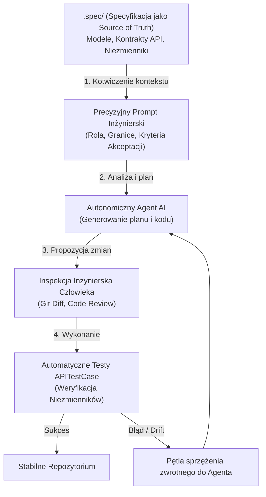
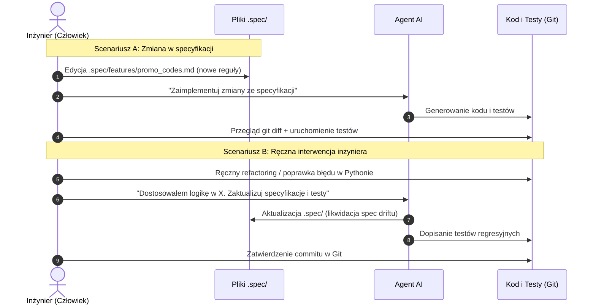

# Aplikacje WWW, semestr 2026Z

## Lab Extra 03 – Spec-Driven Development (SDD) z agentami AI: Architektura specyfikacji, sterowanie agentem i spójność kodu
---

### 1. Wprowadzenie: Od „Vibe Codingu” do Spec-Driven Development

Współczesny inżynier oprogramowania coraz rzadziej pisze powtarzalny kod od zera – zamiast tego korzysta z zaawansowanych agentów autonomicznych i asystentów AI (takich jak Google Antigravity, GitHub Copilot Workspace, Claude Code czy Cursor). 

Jednak praca z modelami językowymi (LLM) bez dyscypliny inżynierskiej prowadzi do tzw. **vibe codingu**: programista wysyła ogólnikowe prompty (*"dodaj mi kody rabatowe i zrób żeby działało"*), agent generuje setki linii kodu, który z pozoru działa, lecz:
* łamie przyjęte konwencje architektoniczne,
* dodaje niepotrzebne zewnętrzne biblioteki,
* ignoruje przypadki brzegowe i wyścigi danych (race conditions),
* wreszcie – rozjeżdża się z pierwotnymi założeniami projektu po kilku kolejnych iteracjach.

**Spec-Driven Development (SDD)** to metodyka, w której **specyfikacja systemu stanowi nadrzędne, wersjonowane źródło prawdy (Single Source of Truth)**. Zamiast improwizować w oknie czatu, programista formułuje precyzyjne kontrakty, niezmienniki biznesowe i kryteria akceptacji. Agent staje się wówczas wykonawcą o ściśle wyznaczonych granicach, a nie chaotycznym generatorem losowego kodu.



---

### 2. Anatomia repozytorium opartego o specyfikację (`.spec/`)

W profesjonalnym projekcie Django/DRF specyfikacja nie jest zapomnianym dokumentem PDF na dysku Google Drive. Znajduje się bezpośrednio w repozytorium Git w dedykowanym katalogu (np. `.spec/` lub `docs/spec/`), ewoluując wraz z kodem:

```text
eventhub/
├── .spec/
│   ├── 00_architecture_guidelines.md   # Wersje (Python 3.13, Django 6.1), konwencje PEP 8, JWT, guardrails
│   ├── 01_domain_models.md             # Modele ORM, typy pól, relacje, właściwości obliczane
│   ├── 02_api_contracts.md             # Ścieżki REST, kody HTTP, struktury JSON, nagłówki Auth
│   ├── 03_business_invariants.md       # Żelazne reguły (brak overbookingu, transakcje atomowe)
│   └── features/                       # Specyfikacje konkretnych funkcjonalności (RFC / User Stories)
│       └── promo_codes.md              # Przykład: Moduł kodów rabatowych
├── events/                             # Aplikacja Django
├── eventhub/                           # Konfiguracja projektu
└── manage.py
```

Każdy z tych plików odpowiada na inne pytanie:
1. `00_architecture_guidelines.md` – *W jakich ramach technologicznych i stylistycznych się poruszamy?*
2. `01_domain_models.md` – *Jakie encje i relacje reprezentują naszą domenę biznesową?*
3. `02_api_contracts.md` – *Jak wygląda interfejs sieciowy dla klientów zewnętrznych?*
4. `03_business_invariants.md` – *Jakich prawideł logicznych pod żadnym pozorem nie wolno złamać?*
5. `features/*.md` – *Co dokładnie ma robić nowo wdrażana funkcja i jakie są jej kryteria akceptacji (Given-When-Then)?*

---

### 3. Sekcje „Dlaczego to ważne?”

---

#### 3.1. Dlaczego specyfikacja jest tarczą przed halucynacjami i degradacją architektury?

Modele LLM działają na zasadzie przewidywania najbardziej prawdopodobnych tokenów na podstawie dostarczonego kontekstu. Jeśli kontekst jest niejednoznaczny lub ubogi, model uzupełnia luki statystycznymi domysłami (często zmyślając nazwy pól, używając przestarzałych bibliotek lub stosując niewłaściwe wersje frameworka).

> [!IMPORTANT]
> ### 💡 Dlaczego to ważne?
> 1. **Ograniczenie przestrzeni rozwiązań (Constrained Generation):** Dostarczenie agentowi pliku specyfikacji redukuje przestrzeń niepewności niemal do zera. Zamiast zgadywać, czy bilet ma pole `code` czy `ticket_code`, agent odczytuje definicję wprost z `.spec/01_domain_models.md`.
> 2. **Ochrona przed degradacją kodu (Architectural Drift):** Bez wytycznych architektonicznych agent może w jednym widoku zastosować `APIView`, w drugim `ModelViewSet`, a w trzecim surowy widok funkcyjny Django, wprowadzając bałagan technologiczny.
> 3. **Eliminacja zależności widmo:** Narzucenie żelaznej zasady *"Nie dodawaj nowych bibliotek bez wyraźnej zgody w specyfikacji"* zapobiega instalacji niebezpiecznych lub porzuconych pakietów PyPI ([OWASP Top 10 for LLM: Supply Chain Vulnerabilities](https://genai.owasp.org/llm-top-10/)).
> 4. **Literatura:** Badania inżynierii oprogramowania wspomaganej przez AI wskazują, że kotwiczenie w specyfikacji (Context Grounding) drastycznie obniża wskaźnik defektów logicznych ([Martin Fowler: Software Design in the Age of AI](https://martinfowler.com/articles/exploring-gen-ai.html)).

---

#### 3.2. Problem „Spec Drift” (Rozjazdu specyfikacji i kodu): Jak utrzymać Single Source of Truth?

Największym zagrożeniem w tradycyjnej inżynierii oprogramowania było to, że dokumentacja stawała się nieaktualna już w kilka dni po jej sporządzeniu. W metodologii SDD specyfikacja jest **dokumentacją żyjącą (Living Documentation)**.

> [!WARNING]
> ### 💡 Dlaczego to ważne?
> 1. **Gdy kod mija się ze specyfikacją, system staje się nieprzewidywalny:** Jeśli w kodzie zmienimy nazwę parametru z `promo_code` na `voucher`, ale nie zaktualizujemy specyfikacji ani kontraktu OpenAPI, aplikacja mobilna lub frontend SPA przestaną działać bez żadnego ostrzeżenia na backendzie.
> 2. **Zasada nadrzędności specyfikacji (Spec First, Code Second):** Każda zmiana założeń biznesowych musi najpierw trafić do pliku `.spec/`, a dopiero w drugim kroku zostać zaimplementowana w kodzie.
> 3. **Automatyczna weryfikacja kontraktu:** W ekosystemie Django biblioteka `drf-spectacular` pozwala na automatyczne generowanie schematu OpenAPI z kodu (`python manage.py spectacular --file schema.yml`). Porównanie tego schematu z kontraktem w `.spec/02_api_contracts.md` w potoku CI/CD natychmiast ujawnia rozbieżności ([Contract-First API Design](https://swagger.io/resources/articles/adopting-an-api-first-approach/)).

---

#### 3.3. Higiena pracy hybrydowej (Human + Agent Pair Programming)

Praca z autonomicznym agentem nie polega na bezkrytycznym klikaniu *"Zaakceptuj wszystko"*. Programista pełni rolę **głównego architekta i weryfikatora (Human-in-the-Loop)**.

> [!CAUTION]
> ### 💡 Dlaczego to ważne?
> 1. **Odpowiedzialność inżynierska:** Za błędy na produkcji, wycieki danych czy awarie transakcji odpowiada programista podpisujący commit, a nie model językowy ([SEI: Human-AI Teaming in Software Development](https://www.sei.cmu.edu/)).
> 2. **Atomowość zmian i inspekcja diffów:** Agent powinien realizować małe, pojedyncze zadania na dedykowanych gałęziach Git (`git checkout -b feat/promo-codes`). Przed zatwierdzeniem zmian inżynier bezwzględnie analizuje `git diff`.
> 3. **Testy jednostkowe i integracyjne jako nieprzekupny arbiter:** Kod wygenerowany przez AI jest uznany za poprawny dopiero wtedy, gdy przejdzie zestaw testów automatycznych (`rest_framework.test.APITestCase`) odzwierciedlających kryteria akceptacji zdefiniowane w specyfikacji.

---

### 4. Wzorce komunikacji z agentem (Prompt Engineering & Steering w SDD)

Komunikacja z agentem w metodyce SDD opiera się na 4 fundamentalnych filarach:

#### Wzorzec 1: Kotwiczenie w plikach specyfikacji (Context Anchoring)
Zamiast opisywać problem od zera, odwołujemy się do konkretnych ścieżek plików w repozytorium:

> **❌ Zły prompt (Vibe coding):**  
> *"Napisz mi model dla kodów rabatowych i dodaj do tego endpoint."*

> **✅ Wzorzec SDD (Context Anchored Prompt):**  
> *"Działasz jako Senior Backend Developer Django. Twoim zadaniem jest implementacja modułu kodów rabatowych zgodnie ze specyfikacją w `.spec/features/promo_codes.md`. Przestrzegaj wytycznych architektonicznych z `.spec/00_architecture_guidelines.md` oraz konwencji modeli z `.spec/01_domain_models.md`. Zastosuj wyłącznie Django 6.1 i DRF. Nie instaluj żadnych nowych bibliotek. Przed wygenerowaniem kodu przedstaw krótki plan kroków."*

---

#### Wzorzec 2: Tryb wywiadu i doprecyzowania wymagań (Interview Mode)
Przed przystąpieniem do kodowania zmuś agenta do analizy luk w specyfikacji:

> **✅ Prompt na rozpoczęcie pracy z nową funkcją:**  
> *"Przeczytaj specyfikację w `.spec/features/promo_codes.md`. Przeanalizuj ją pod kątem potencjalnych luk logicznych, nieobsłużonych przypadków brzegowych oraz wyścigów danych (race conditions). Jeśli cokolwiek jest niejednoznaczne, zadaj mi do 3 konkretnych pytań doprecyzowujących, zanim przejdziesz do planowania kodu."*

---

#### Wzorzec 3: Żelazne granice (Guardrails & Negative Constraints)
Jasno zdefiniuj, czego agentowi **nie wolno** dotykać:

> **✅ Prompt z ograniczeniami:**  
> *"Wprowadź zmiany wyłącznie w plikach `events/models.py`, `events/serializers.py` oraz `events/views.py`. Nie modyfikuj istniejącej logiki rezerwacji biletów w `events/views.py#book`. Nie zmieniaj konfiguracji uwierzytelniania w `settings.py`."*

---

### 5. Cykl życia zmian: Jak wdrażać poprawki ręczne i automatyczne

W codziennej pracy inżynier i agent wymieniają się zadaniami. Poniżej przedstawiono standardowe scenariusze postępowania:



---

### 6. Warsztat praktyczny: Implementacja modułu kodów rabatowych (`PromoCode`) krok po kroku

W ramach ćwiczenia zrealizujesz pełny cykl SDD na działającym projekcie **EventHub**.

#### Krok 1: Zapoznanie ze specyfikacją modułu
Otwórz przygotowany plik [.spec/features/promo_codes.md]. Zwróć uwagę na:
* Strukturę pól modelu `PromoCode` (rabat procentowy, limit użyć, data ważności).
* Niezmiennik atomowości użycia kodu (`usages_count < max_usages` w `transaction.atomic()`).
* Kontrakt endpointu `/events/api/v1/events/{id}/apply-promo/`.

#### Krok 2: Zlecenie agentowi przygotowania planu
Uruchom agenta i podaj prompt:
```text
Działając zgodnie z wytycznymi w .spec/00_architecture_guidelines.md, przygotuj plan wdrożenia modułu kodów rabatowych opisanego w .spec/features/promo_codes.md.
Plan powinien obejmować:
1. Migrację bazy danych dla modelu PromoCode w events/models.py.
2. Serializator walidujący kod rabatowy w events/serializers.py.
3. Dedykowaną akcję @action w EventViewSet w events/views.py.
4. Zestaw testów APITestCase weryfikujących kryteria akceptacji.
Nie pisz jeszcze kodu – przedstaw najpierw sam plan.
```

#### Krok 3: Wygenerowanie kodu i testów
Po zaakceptowaniu planu poproś agenta o wygenerowanie implementacji i testów. Upewnij się, że testy sprawdzają:
* Przypadek sukcesu (200 OK z poprawnie przeliczoną ceną).
* Kod wygasły (400 Bad Request).
* Kod przekraczający `max_usages` (400 Bad Request).
* Użycie kodu dla innego wydarzenia (400 Bad Request).

#### Krok 4: Ręczna interwencja programisty (Human Intervention)
Załóżmy, że podczas przeglądu kodu zauważasz, że kody rabatowe powinny być zapisywane zawsze wielkimi literami (case-insensitive), aby użytkownik wpisujący `summer2026` nie dostał błędu.

Wykonaj zmianę **ręcznie** w metodzie `save()` modelu w `events/models.py`:
```python
def save(self, *args, **kwargs):
    self.code = self.code.upper().strip()
    super().save(*args, **kwargs)
```

#### Krok 5: Synchronizacja specyfikacji przez agenta (Eliminacja Spec Driftu)
Nigdy nie zostawiaj kodu bez aktualizacji specyfikacji! Wyślij agentowi prompt:
```text
Zmodyfikowałem ręcznie metodę save() modelu PromoCode w events/models.py, aby kod był automatycznie zamieniany na wielkie litery (uppercase) i pozbawiany białych znaków.
1. Zaktualizuj plik .spec/features/promo_codes.md w sekcji 1 i 2, dodając tę regułę do specyfikacji.
2. Dodaj test jednostkowy weryfikujący, że kod rabatowy utworzony z małymi literami zadziała poprawnie przy zapytaniu HTTP z wielkimi literami.
```

#### Krok 6: Inspekcja zmian i zatwierdzenie w Git
Sprawdź w terminalu:
```bash
git status
git diff .spec/
git diff events/
python manage.py test events
```

Jeśli testy przechodzą pomyślnie, zacommituj zmiany:
```bash
git add .spec/ events/
git commit -m "feat(promo-codes): implement PromoCode module according to spec"
```

---

### 7. Zadania do wykonania i ocena

1. **Wdrożenie modułu `PromoCode`:** Zrealizuj kroki warsztatowe 1–6 przy użyciu agenta AI i metodyki SDD.
2. **Własna funkcja w metodyce SDD (Zadanie indywidualne):**
   * Wybierz jedną nową funkcjonalność dla EventHub, np.:
     * *System recenzji i ocen wydarzeń (`EventReview` z oceną 1–5 gwiazdek)*, LUB
     * *Lista oczekujących na wyprzedane wydarzenia (`WaitlistEntry`)*.
   * Napisz specyfikację w nowym pliku `.spec/features/<nazwa_funkcji>.md` zawierającą: model danych, niezmienniki biznesowe, kontrakt API oraz kryteria akceptacji Given-When-Then.
   * Zleć agentowi implementację na podstawie Twojej specyfikacji.
   * Zadbaj o brak rozjazdu (Spec Drift) i przygotuj minimum 3 testy automatyczne w `APITestCase`.
3. **Sprawozdanie:** W pliku `docs/sdd_report.md` opisz krótko:
   * Jakie luki w Twojej wstępnej specyfikacji wykrył agent podczas planowania?
   * Jaki problem rozwiązałeś ręcznie i jak poinstruowałeś agenta, by zaktualizował specyfikację?
   * Wynik polecenia `git diff` oraz zrzut ekranu z pomyślnego wykonania testów.
